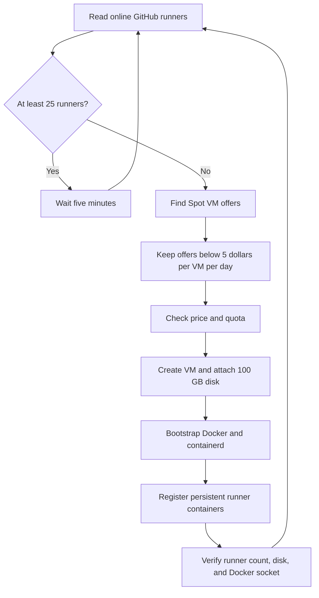

# Spot runner fleet

This repository contains Python tools for finding affordable GCP Spot
VMs, provisioning persistent GitHub Actions runners, and restoring runner
capacity after interruptions. The fleet belongs to the `swack-tools`
organization and uses the repository-scoped `oxidex-m4air` runner group for
`swack-tools/oxidex`.

## How the fleet works



The autoscaler checks the `spot` label by default. Docker builders use the
separate `docker` label and do not count toward the Spot runner floor. GitHub
adds the standard `self-hosted`, `Linux`, and `X64` labels to both pools. Spot
runners also receive `spot` and optional machine and region labels. Docker
runners receive `docker` and optional machine and region labels. The autoscaler
launches a whole host at a time and verifies registrations before it reports a
successful deployment. Spot VM prices cover compute only. Persistent disks and
network use have separate charges.

## Storage layout

The attached persistent disk mounts at `/mnt/runner-data`. Bootstrap configures
all large and job-related storage there:

| Data | Path |
| --- | --- |
| Docker images and build cache | `/mnt/runner-data/docker` |
| containerd image layers and overlays | `/mnt/runner-data/containerd` |
| Runner configuration and credentials | `/mnt/runner-data/instances/<runner>` |
| Runner workspace and job files | `/mnt/runner-data/work/<runner>` |

Moving only Docker's `data-root` leaves containerd snapshots on the boot disk.
The bootstrap copies existing containerd data to the attached disk, configures
containerd to use that path, restarts Docker, then removes the old default storage.
Each runner's `/` filesystem should report about 98 GiB because its container
overlay uses the attached disk. Only the two `docker` pool runners receive the
host Docker socket; ordinary `spot` runners cannot access it. The manager checks
the runner filesystem and socket separation before it reports success. The boot
disk keeps the operating system and packages; increase the data disk only when
its observed free space requires it.

## Runner sizing

Runner count depends on vCPU capacity. Each runner receives four vCPU. Reserve
8 GiB of host RAM, then divide the remaining memory evenly:

```text
runner_count = host_vCPU // 4
runner_RAM_GiB = (host_RAM_GiB - 8) // runner_count
```

For a 32-vCPU, 128-GiB VM, the calculation is `(128 - 8) / 8 = 15 GiB` per
runner. A 32-vCPU, 256-GiB VM gives 31 GiB per runner. `--fixed-runner-sizing`
uses the explicit values for runner count, vCPU, and RAM.

## Requirements and credentials

Install and authenticate the GCP and GitHub command-line tools:

- `gcloud` needs permission to inspect Compute Engine prices, quotas, VMs, and
disks in project `homelab-424523`.
- `gh` needs permission to manage organization Actions runners in
  `swack-tools`.
- The runner group must be selected-repository scoped and include
  `swack-tools/oxidex`.

The manager obtains a short-lived runner registration token when it deploys a
host. Do not save that registration token in `.env`; it expires quickly. Set
`GH_TOKEN` in the local, ignored `.env` file to a renewable GitHub credential
with the required organization permissions. The manager passes the one-use
registration token through temporary startup metadata, waits for the exact
bootstrap run to finish, then removes the metadata key. It does not write the
token to the image or persistent disk.

Copy `.env.example` to `.env`, then add the GitHub credential. The `.env` file
is ignored by Git. The autoscaler also reads optional `GOOGLE_CLOUD_API_KEY` for
GCP Billing Catalog price lookup. GCP API calls use the active
`gcloud` credentials.

## Preview a deployment

The preview checks the live machine type, Spot compute price, and available CPU
quota. It does not create a disk or VM.

```bash
python3 src/spot_runner_manager.py \
  --max-cost 0.4 \
  --instance-type n2-standard-32 \
  --region asia-south2 \
  --ram 128 --cpu 32
```

`--max-cost` is the strict hourly compute limit for one VM. The manager refuses
to provision at a price greater than or equal to that limit. Disk charges are separate.

## Deploy a host

```bash
python3 src/spot_runner_manager.py \
  --max-cost 0.208333333 \
  --instance-type n2-standard-32 \
  --region northamerica-northeast2 --zone northamerica-northeast2-a \
  --ram 128 --cpu 32 \
  --disk-size-gb 100 \
  --instance-name oxidex-runners-nane2-example \
  --disk-device-name runner-data-example \
  --runner-prefix oxidex-example \
  --runner-label spot \
  --apply
```

The manager verifies current Spot rates and quota before creating resources. It
uses a Spot VM with a 40-GiB boot disk and a 100-GiB `pd-balanced` data
disk configured to delete with its VM. Stopping a VM preserves the data disk;
deleting the VM removes its attached runner disk as well. Before deployment,
the manager also removes unattached disks carrying its ownership label in the
target zone, which cleans up disks left after failed VM creation. It never
deletes attached disks or disks without its ownership label. GCE startup metadata installs Docker and Compose, configures Docker and
containerd storage, builds the runner image, and registers the persistent
containers. The manager waits for a deployment-specific completion marker and
checks disk and Docker access before returning success.

Pass `--existing-instance` only when adopting a Spot VM with a supported machine
type and disk configuration. The manager restarts the host to apply the current
bootstrap script. It waits for that script's unique completion marker before
removing startup metadata, so old runner registrations cannot masquerade as a
completed update.

## Inspect fleet status

```bash
python3 src/runner_fleet.py \
  --org swack-tools \
  --project homelab-424523 \
  --label spot \
  --minimum-runners 25 \
  --runners-per-vm 8
```

The `src/lib/runner_fleet.py` module exposes functions to list and count online
organization runners, list and count running GCP VMs, observe both
systems, and calculate scale-out capacity. These functions do not create or
delete resources.

## Run the autoscaler

Run one check and scale pass:

```bash
python3 src/spot_runner_autoscaler.py --once
```

Run continuously with the default target of 25 online `spot` runners, a
five-minute interval, and a strict compute ceiling of $5 per VM per day:

```bash
python3 src/spot_runner_autoscaler.py
```

The autoscaler scans Spot offers, removes offers priced at the daily cap or higher, then asks the deployment manager to create enough hosts to cover
the deficit. A 32-vCPU host reserves two runners for the `docker` pool, so it
adds six runners to the `spot` pool. It logs errors and retries on the next
interval. It does not delete VMs or interrupt busy runners.

To install a per-user macOS LaunchAgent that starts at login and restarts the
process if it exits, run:

```bash
python3 src/spot_runner_autoscaler.py --install-launch-agent
```

The LaunchAgent needs the Mac to be powered on, awake, and logged in. It uses
the current user's `gcloud` and `gh` credentials. Review its status with
`launchctl print gui/$(id -u)/com.swacktools.spot-runner-autoscaler` and its log
at `~/Library/Logs/spot-runner-autoscaler.log`.

## Repository layout

- `src/spot_runner_manager.py` is the provisioning command-line entry point.
- `src/spot_runner_autoscaler.py` is the continuous scale-out entry point.
- `src/runner_fleet.py` is the fleet status command-line entry point.
- `src/spot_finder.py` is the Spot offer search command-line entry point.
- `src/lib/` contains reusable fleet, pricing, provisioning, and autoscaling methods.
- `src/lib/runner_assets.py` embeds the startup script, image definition, and entrypoint.
- `tests/` contains unit tests for pricing and capacity rules.

Run the Python checks from the repository root:

```bash
PYTHONPATH=src python3 -m unittest discover -s tests -v
python3 -m py_compile src/*.py src/lib/*.py
```

## Safety and workflow routing

The runner group is limited to the OxiDex repository. Keep untrusted pull
request code off persistent self-hosted runners. Route macOS signing and release
jobs to macOS hosts; the Spot VMs in this fleet run Linux. Before changing CI to
use `runs-on: spot`, keep at least 25 labeled runners online for 10 minutes and
verify that the Docker client, host daemon, and runner filesystem checks pass.
